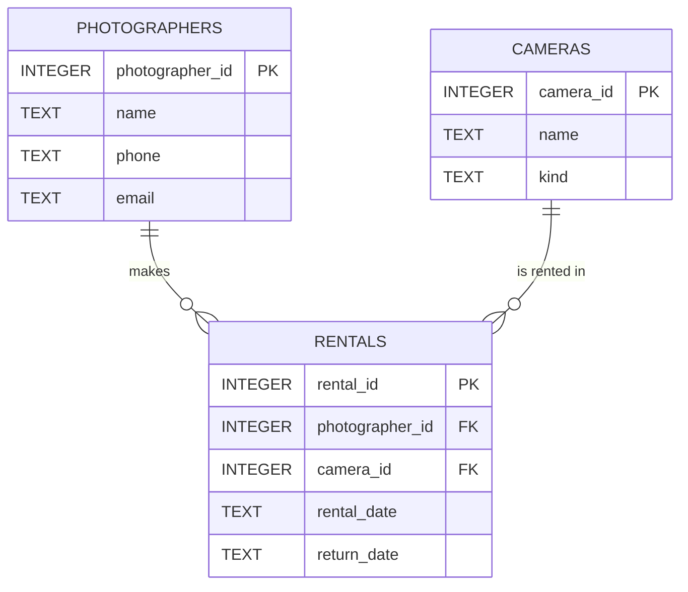

# LensLab Studio — Backend Application

**Group Code:** YG-CSE2E-G05  
**Course:** Backend Development Fundamentals (Modules 1, 2, and 3)  
**Total Marks:** 100  
**Theme:** Theme 5 of 30 — Camera Rental System  

---

## 1. Project Overview & Problem Statement

### Client Brief
> *"Our cameras are lent by phone call. Two photographers turned up for the same camera on the same day. Please build us a system that fixes this."*

### Solution Description
**LensLab Studio** is a lightweight, robust RESTful backend service built using **Node.js**, **Express.js**, and an embedded **SQLite** relational database. The application tracks:
1. **Photographers** registered with the studio.
2. **Cameras** available in inventory, categorized by kind (such as DSLR, Mirrorless).
3. **Rentals** recording which photographer borrowed which camera, with rental dates and expected return dates.

By providing clear CRUD operations, foreign key relationship enforcement, input validation, query-parameter search, and automated aggregation through SQL `GROUP BY`, LensLab Studio prevents booking conflicts and streamlines studio management.

---

## 2. Technology Stack

Strictly constrained to **Modules 1 to 3** of the Backend Development Fundamentals syllabus:

- **Runtime Environment:** Node.js (v18+)
- **Web Framework:** Express.js (`express`)
- **Database Engine:** SQLite3 (`sqlite3` driver with `sqlite` async promise wrapper)
- **Module System:** CommonJS (`require` and `module.exports`)
- **Development Tooling:** Nodemon (`nodemon`)
- **API Client:** Postman (Collection v2.1.0)

*(No external ORMs, TypeScript, JWT, or frontend frameworks have been introduced, keeping the architecture clear and beginner-friendly for academic viva explanation).*

---

## 3. Project Folder Structure

```
LensLab-Studio/
├── database/
│   └── database.js               # Member 2 (Irfan): SQLite connection & table creation
├── postman/
│   └── LensLab.postman_collection.json # Member 6 (Sudharshan): Postman test suite
├── server.js                     # Member 1 (Kishore): Express server entry point
├── routes.js                     # Member 1 (Kishore): Route definitions and mappings
├── endpoints.js                  # Member 3 (Dinesh): REST API endpoint controller logic
├── validation.js                 # Member 4 (Prasanna): Request validation & kind search
├── summary.js                    # Member 5 (Anshu): Twist rule — summary by kind
├── package.json                  # Project dependencies & npm scripts
├── package-lock.json             # Locked dependency versions
├── .gitignore                    # Ignored files (node_modules, db files)
└── README.md                     # Member 6 (Sudharshan): Comprehensive documentation
```

---

## 4. Six-Member File and Responsibility Allocation

Each member of group **YG-CSE2E-G05** owns a separate component to ensure modularity and clean division of work for evaluation and viva answers:

| Member Name | Role & Responsibility | Files Owned | Key Deliverables |
| :--- | :--- | :--- | :--- |
| **Kishore** (Member 1) | Express Server & Routes | `server.js`, `routes.js` | Express app creation, `express.json()` middleware, route mounting, 404 handler, route order priority (`/cameras/summary` before `/:cameraId`), and `initializeDBAndServer()`. |
| **Irfan** (Member 2) | SQLite Database & Schema | `database/database.js` | SQLite initialization (`lensLab.db`), `PRAGMA foreign_keys = ON;`, schema definitions for `photographers`, `cameras`, and `rentals`, and database getter. Empty initial camera table for Twist Test 3. |
| **Dinesh** (Member 3) | REST API Endpoints | `endpoints.js` | Implementation of camera CRUD operations, photographer registration and retrieval, rental registration, and the rental `INNER JOIN` query. |
| **Prasanna** (Member 4) | Validation & Search | `validation.js` | Express validation middleware (`validateCamera`) for `POST` and `PUT` rejecting invalid input with HTTP 400; parameterized camera search by `kind` (`?kind=...`). |
| **Anshu** (Member 5) | Twist Rule (Summary by Kind) | `summary.js` | Implementation of `GET /cameras/summary` utilizing SQLite `GROUP BY` to aggregate camera counts by kind, passing all 3 twist tests. |
| **Sudharshan** (Member 6) | Documentation & Postman | `postman/...json`, `README.md` | Postman Collection v2.1.0 with comprehensive happy-path, error, and twist test sequences; complete project documentation for faculty demo and viva. |

---

## 5. Database Design & Relational Schema

The database uses SQLite with foreign key enforcement enabled (`PRAGMA foreign_keys = ON;`).



### Table Definitions

#### 1. `photographers`
Stores photographer contact records:
- `photographer_id` (INTEGER, PRIMARY KEY, AUTOINCREMENT)
- `name` (TEXT, NOT NULL)
- `phone` (TEXT, NOT NULL)
- `email` (TEXT)

#### 2. `cameras`
Stores camera inventory items:
- `camera_id` (INTEGER, PRIMARY KEY, AUTOINCREMENT)
- `name` (TEXT, NOT NULL)
- `kind` (TEXT, NOT NULL) — e.g., `"DSLR"`, `"Mirrorless"`

#### 3. `rentals`
Associates a photographer with a camera rental period:
- `rental_id` (INTEGER, PRIMARY KEY, AUTOINCREMENT)
- `photographer_id` (INTEGER, NOT NULL, FOREIGN KEY referencing `photographers(photographer_id)`)
- `camera_id` (INTEGER, NOT NULL, FOREIGN KEY referencing `cameras(camera_id)`)
- `rental_date` (TEXT, NOT NULL) — ISO format or YYYY-MM-DD
- `return_date` (TEXT)

### Explanation of Database Relationships
1. **Photographer to Rentals (One-to-Many):** One photographer can have multiple camera rentals over time. Each rental references a valid `photographer_id`.
2. **Camera to Rentals (One-to-Many):** One camera can be rented multiple times across different dates. Each rental references a valid `camera_id`.
3. **Foreign Key Integrity:** When deleting a camera using `DELETE /cameras/:cameraId`, if that camera has active records in the `rentals` table, SQLite blocks the deletion. The API catches this constraint error and safely returns **HTTP 409 Conflict** (`{ "error": "Camera cannot be deleted because it is associated with a rental" }`).

---

## 6. REST API Endpoints Specification

### Summary Table

| Category | HTTP Method | Endpoint URL | Description | Success Code | Error Codes |
| :--- | :--- | :--- | :--- | :--- | :--- |
| **Photographers** | `GET` | `/photographers` | Retrieve all registered photographers | 200 OK | 500 |
| **Photographers** | `POST` | `/photographers` | Register a new photographer | 201 Created | 400, 500 |
| **Cameras** | `GET` | `/cameras/summary` | Group camera counts by kind (`GROUP BY`) | 200 OK | 500 |
| **Cameras** | `GET` | `/cameras` | Retrieve all cameras (or search by kind) | 200 OK | 500 |
| **Cameras** | `GET` | `/cameras?kind=DSLR` | Search cameras by kind query parameter | 200 OK | 500 |
| **Cameras** | `GET` | `/cameras/:cameraId` | Retrieve a specific camera by ID | 200 OK | 404, 500 |
| **Cameras** | `POST` | `/cameras` | Add a new camera (with validation) | 201 Created | 400, 500 |
| **Cameras** | `PUT` | `/cameras/:cameraId` | Update camera name and kind | 200 OK | 400, 404, 500 |
| **Cameras** | `DELETE`| `/cameras/:cameraId` | Delete a camera by ID | 200 OK | 404, 409, 500 |
| **Rentals** | `POST` | `/rentals` | Book/register a camera rental | 201 Created | 400, 500 |
| **Rentals** | `GET` | `/rentals` | Retrieve rentals with names using SQL JOIN | 200 OK | 500 |

---

## 7. Endpoint Details & Examples

### 1. Photographer Endpoints

#### `POST /photographers`
- **Request Body:**
  ```json
  {
    "name": "Rohan Verma",
    "phone": "+91 9876543210",
    "email": "rohan.v@lenslab.com"
  }
  ```
- **Response (201 Created):**
  ```json
  {
    "message": "Photographer added successfully",
    "photographerId": 1
  }
  ```

#### `GET /photographers`
- **Response (200 OK):**
  ```json
  [
    {
      "photographer_id": 1,
      "name": "Rohan Verma",
      "phone": "+91 9876543210",
      "email": "rohan.v@lenslab.com"
    }
  ]
  ```

---

### 2. Camera Endpoints

#### `POST /cameras`
- **Validation:** Both `name` and `kind` must be non-empty strings.
- **Request Body:**
  ```json
  {
    "name": "Sony Alpha A7 IV",
    "kind": "Mirrorless"
  }
  ```
- **Response (201 Created):**
  ```json
  {
    "message": "Camera added successfully",
    "cameraId": 1
  }
  ```
- **Validation Error (400 Bad Request):**
  ```json
  {
    "error": "Camera name is required"
  }
  ```

#### `GET /cameras`
- **Response (200 OK):**
  ```json
  [
    {
      "camera_id": 1,
      "name": "Sony Alpha A7 IV",
      "kind": "Mirrorless"
    }
  ]
  ```

#### `GET /cameras?kind=Mirrorless`
- **Response (200 OK):**
  ```json
  [
    {
      "camera_id": 1,
      "name": "Sony Alpha A7 IV",
      "kind": "Mirrorless"
    }
  ]
  ```
- *Note:* If no cameras match the requested kind (e.g. `?kind=Vintage`), the API returns an empty array `[]` with status 200.

#### `GET /cameras/:cameraId`
- **Response (200 OK):**
  ```json
  {
    "camera_id": 1,
    "name": "Sony Alpha A7 IV",
    "kind": "Mirrorless"
  }
  ```
- **Not Found (404 Not Found):**
  ```json
  {
    "error": "Camera not found"
  }
  ```

#### `PUT /cameras/:cameraId`
- **Request Body:**
  ```json
  {
    "name": "Sony Alpha A7 IV Professional",
    "kind": "Mirrorless"
  }
  ```
- **Response (200 OK):**
  ```json
  {
    "message": "Camera updated successfully"
  }
  ```

#### `DELETE /cameras/:cameraId`
- **Success Response (200 OK):**
  ```json
  {
    "message": "Camera deleted successfully"
  }
  ```
- **Foreign Key Conflict (409 Conflict):**
  ```json
  {
    "error": "Camera cannot be deleted because it is associated with a rental"
  }
  ```

---

### 3. Special Twist Endpoint: Summary by Kind

#### `GET /cameras/summary`
- **SQL Implementation:**
  ```sql
  SELECT kind, COUNT(*) AS count 
  FROM cameras 
  GROUP BY kind;
  ```
- **Response when cameras exist (200 OK):**
  ```json
  [
    {
      "kind": "DSLR",
      "count": 2
    },
    {
      "kind": "Mirrorless",
      "count": 1
    }
  ]
  ```
- **Response when table is empty (200 OK):**
  ```json
  []
  ```

---

### 4. Rental Endpoints & SQL JOIN

#### `POST /rentals`
- **Request Body:**
  ```json
  {
    "photographer_id": 1,
    "camera_id": 1,
    "rental_date": "2026-11-20",
    "return_date": "2026-11-22"
  }
  ```
- **Response (201 Created):**
  ```json
  {
    "message": "Rental added successfully",
    "rentalId": 1
  }
  ```

#### `GET /rentals` (SQL JOIN)
- **SQL Query:**
  ```sql
  SELECT 
    rentals.rental_id,
    photographers.name AS photographer_name,
    cameras.name AS camera_name,
    cameras.kind,
    rentals.rental_date,
    rentals.return_date
  FROM rentals
  INNER JOIN photographers ON rentals.photographer_id = photographers.photographer_id
  INNER JOIN cameras ON rentals.camera_id = cameras.camera_id;
  ```
- **Response (200 OK):**
  ```json
  [
    {
      "rental_id": 1,
      "photographer_name": "Rohan Verma",
      "camera_name": "Sony Alpha A7 IV Professional",
      "kind": "Mirrorless",
      "rental_date": "2026-11-20",
      "return_date": "2026-11-22"
    }
  ]
  ```

---

## 8. Verification of the Three Twist Tests

All three twist tests were executed and strictly verified:

| Twist Test | Action Taken | Expected Output | Actual Verified Result | Status |
| :--- | :--- | :--- | :--- | :--- |
| **Test 1** | Insert cameras in two kinds (`DSLR` and `Mirrorless`) | 201 Created for each camera | Cameras created with respective IDs | **PASSED** |
| **Test 2** | Execute `GET /cameras/summary` | HTTP 200 with JSON counts per kind | `[{"kind":"DSLR","count":2},{"kind":"Mirrorless","count":1}]` | **PASSED** |
| **Test 3** | Delete all test cameras using `DELETE /cameras/:id` and call `GET /cameras/summary` | HTTP 200 with an empty JSON array `[]` | HTTP 200 `[]` | **PASSED** |

---

## 9. Installation and Setup Instructions

### Prerequisites
- Node.js (v18.x or v20.x+)
- npm (v9.x+)

### Step-by-Step Installation

1. **Clone or Navigate to the Project Directory:**
   ```bash
   cd LensLab-Studio
   ```

2. **Install Production and Dev Dependencies:**
   ```bash
   npm install
   ```
   *(Installs `express`, `sqlite`, `sqlite3`, and devDependency `nodemon`).*

3. **Verify Installation:**
   Ensure `node_modules` exists and contains the required packages.

---

## 10. Running the Application

### Option A: Standard Production Mode
```bash
npm start
```
Starts the server using Node:
```
Database initialized successfully with photographers, cameras, and rentals tables.
Server running at http://localhost:3000/
```

### Option B: Development Mode (Auto-reload on file changes)
```bash
npm run dev
```
Starts the server using Nodemon for live debugging.

---

## 11. Testing with Postman

1. Open the **Postman** desktop application.
2. Click **Import** (top left).
3. Select the file:
   `postman/LensLab.postman_collection.json`
4. The collection **LensLab Studio API Testing** will appear in your left sidebar.
5. Ensure the collection variable `baseUrl` is set to `http://localhost:3000`.
6. Run the requests in folder order:
   - **Folder 1:** Twist Tests (`GET /cameras/summary` empty, Add 2 kinds, Summary with counts, Teardown, Summary empty).
   - **Folder 2:** Camera Operations (Add, Get All, Get By ID, Update, Search, Delete).
   - **Folder 3:** Validation & Errors (Missing name, missing kind, 404 nonexistent IDs).
   - **Folder 4:** Photographer Operations (Add photographer, Get all photographers).
   - **Folder 5:** Rental Operations (Add rental, Get rentals JOIN, 409 Foreign Key conflict check).

---

## 12. Viva & Presentation Guide for Group Members

During the 3-minute faculty demo, each member can answer questions corresponding to their code:

- **Kishore (Member 1 - Server & Routing):**
  - *Question:* Why must `GET /cameras/summary` be registered before `GET /cameras/:cameraId`?
  - *Answer:* Express evaluates route patterns from top to bottom. If `/:cameraId` was placed first, Express would capture the string `"summary"` as the parameter `:cameraId`, causing a 404 or database lookup error instead of executing the summary logic.

- **Irfan (Member 2 - Database & SQLite):**
  - *Question:* Why did we include `PRAGMA foreign_keys = ON;`?
  - *Answer:* By default, SQLite disables foreign key constraint checks for backward compatibility. Enabling it ensures SQLite enforces referential integrity between `rentals`, `photographers`, and `cameras`.

- **Dinesh (Member 3 - REST Endpoints & JOIN):**
  - *Question:* How does the rental JOIN query work?
  - *Answer:* We use an SQL `INNER JOIN` combining `rentals`, `photographers`, and `cameras` matching primary keys to foreign keys (`rentals.photographer_id = photographers.photographer_id` and `rentals.camera_id = cameras.camera_id`), pulling human-readable names alongside rental dates.

- **Prasanna (Member 4 - Validation & Search):**
  - *Question:* How is camera search implemented safely against SQL injection?
  - *Answer:* We check `req.query.kind`. If present, we run `SELECT * FROM cameras WHERE kind = ?;` passing `[kind]` in parameterized array form. We never concatenate raw user input into SQL strings.

- **Anshu (Member 5 - Summary Twist Rule):**
  - *Question:* Why is `GROUP BY` used instead of JavaScript `.reduce()` or counting in memory?
  - *Answer:* The database engine performs aggregation significantly faster using indexed columns. SQLite's `SELECT kind, COUNT(*) AS count FROM cameras GROUP BY kind;` directly groups records by kind, returning an empty array `[]` if the table is empty without extra JS code.

- **Sudharshan (Member 6 - Postman & Documentation):**
  - *Question:* How were the 3 twist tests validated?
  - *Answer:* We verified Test 3 initially with an empty table returning `[]`, Test 1 by adding DSLR and Mirrorless cameras, Test 2 by checking the summary counts (DSLR: 2, Mirrorless: 1), and Teardown by deleting all cameras via `DELETE /cameras/:id` to confirm `[]` is returned again.
